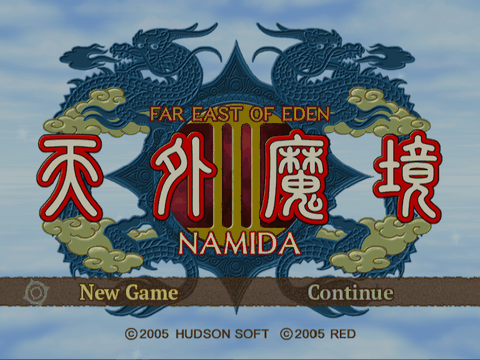
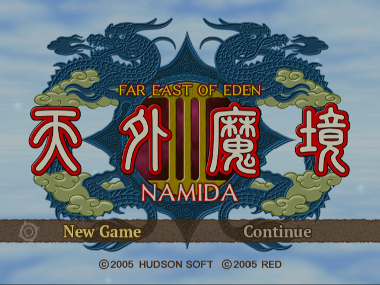
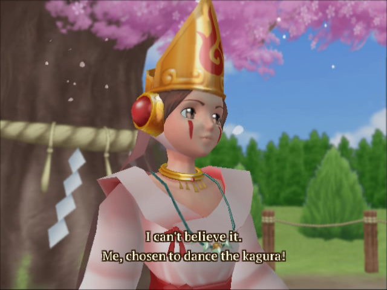
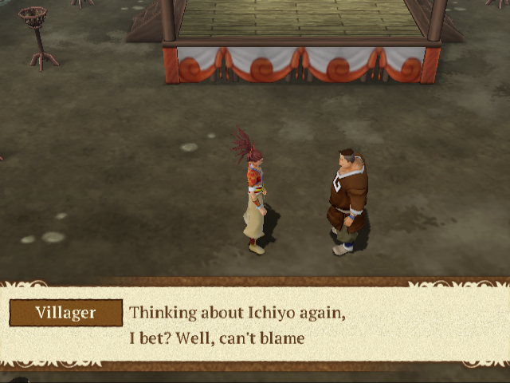
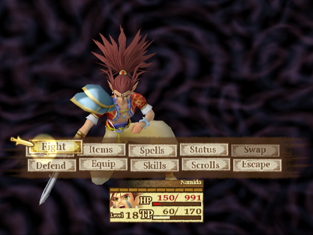
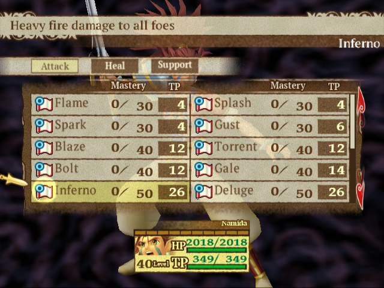
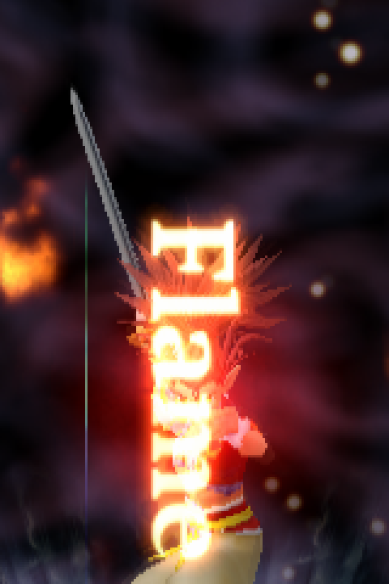
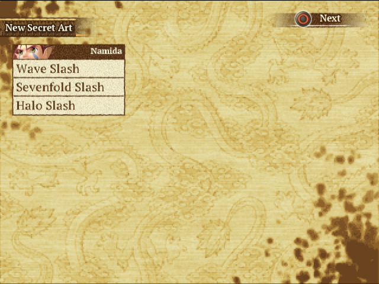
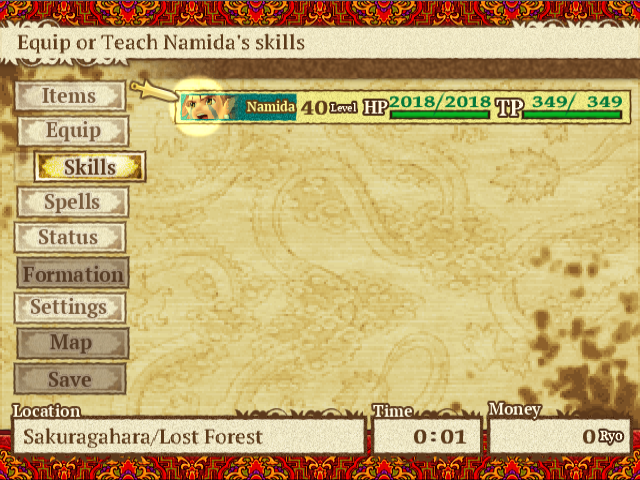
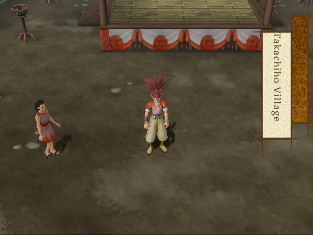

# Tengai Makyou III: Namida — English Translation v1.0

An unofficial English fan translation patch for **Tengai Makyou III: Namida** (PlayStation 2, Hudson / Red Company,
2005, SLPM-65952). It was never released in English, until now.



[Watch the trailer](docs/trailer.mp4) (1 minute, no sound).

| | | |
|---|---|---|
|  |  |  |
|  |  |  |
|  |  |  |

**Found a bug?** [Open an issue](../../issues): untranslated text, typos, overflowing text, crashes. Say where you
were and what was on screen; a savestate helps most.

## Download

Get the zip from the [v1.0 release](../../releases/tag/v1.0). It holds an xdelta patch and a README. The game is not
included: patch your own dump of the Japanese disc.

| | Size | CRC32 | SHA-1 |
|---|---|---|---|
| Japanese disc (input, Redump "Tengai Makyou III - Namida (Japan)") | 4,612,390,912 | `6CC392E5` | `e2949c4fed3dbff862ff92e0d021daccef181690` |
| English disc (output) | 4,612,390,912 | `E61C3D78` | `feaf49bf3d310bb5fd019931d6e9385379dd63d8` |

Apply with xdelta UI or Delta Patcher on Windows, or on the command line:

```sh
xdelta3 -d -B 4612390912 -s "Tengai Makyou III - Namida (Japan).iso" Namida_EN_v1.0.xdelta "Namida_EN.iso"
```

Check the input SHA-1 first: the patch only applies to this exact dump. Start a new game on the patched disc. Tested
in PCSX2 2.8, not yet on real hardware.

## Translation status

| Part | Status |
|---|---|
| Dialogue and story (all event and NPC text, ~27,000 strings) | Translated |
| Menus, items, equipment, spells, battle text, shops, encyclopedias, newspaper | Translated |
| Movies | Subtitles translated; the opening and the castle title cards get English captions |
| Title screen, menu and battle graphics, spell sigils, mini-game graphics | Translated (title logo kept: "Tengai Makyou III NAMIDA") |
| Name entry and typed passwords | English letter keyboard |
| Staff roll | Translated; the brush-calligraphy poems stay as art with English subtitles |
| Signs painted on town buildings (inn, tea house, bath house) | Left in Japanese |

The game uses a new variable-width font (PT Serif). Japanese name readings over kanji are dropped.

## Known issues

- The whole game hasn't been played start to finish on the patched disc yet: later chapters are checked against the
  game data and in an emulator, not by a full playthrough.
- A few signs painted on town buildings are still in Japanese.
- Some short labels use abbreviations to fit small boxes.

## Tools (for modders and other languages)

The Python tools that made this patch are in [`tools/`](tools), with the build script `build.py`, the tests and the
reverse-engineering notes in [`docs/re/`](docs/re) (disc, AFS archives, CMP compression, message format, font, ELF
and DLL patches). This repository does not contain the game, files unpacked from it, or the translation data the
build reads (`script/`, `gfx/labels_*.json`, `subs/`): those hold the game's Japanese text.

| Tool | Purpose |
|---|---|
| `tools/unpack.py`, `iso.py`, `afs.py`, `cmp.py` | Unpack the DVD image, AFS archives and CMP containers; patch files in place |
| `tools/mes.py`, `script.py` | Decode message files; extract every string to `script/*.json` and rebuild them |
| `tools/font.py`, `vwf.py` | The dialogue font and the variable-width English font |
| `tools/elfpatch.py`, `dllpatch.py`, `snrel.py` | Code patches to the executable and the DLL screens (VWF, layouts, sizes) |
| `tools/ofs_tables.py`, `ofs_patch.py`, `evembed.py` | String-offset tables compiled into the code, and messages embedded in maps |
| `tools/txd.py`, `gfx.py`, `gfxdump.py`, `rwgeo.py` | RenderWare textures: dump, survey, redraw text graphics and re-insert |
| `tools/opening.py`, `asr.py` | Captions for the opening and the castle title-card movies |
| `tools/boxes.py`, `batches.py`, `jpleft.py` | Text-width checks per window, translation batches, leftover-Japanese scan |
| `tools/pcsx2.py`, `debugpatch.py`, `routes/` | Scripted emulator testing (PCSX2 + PINE) with a debug build |
| `tools/release.py` | Build, test and package the xdelta patch |

To start a translation into another language from your own dump (`Tengai Makyou III - Namida (Japan).iso`, SHA-1
in `rom.sha1`):

```sh
python3 -m venv .venv && .venv/bin/pip install -r requirements.txt
mkdir rom && ln -s "/path/to/Tengai Makyou III - Namida (Japan).iso" rom/namida.iso
.venv/bin/python -X utf8 tools/unpack.py                              # -> work/
.venv/bin/python -X utf8 tools/script.py extract work/mes script      # -> script/*.json: {"id", "jp", "en"}
# fill in "en" (empty = keep the Japanese), then:
.venv/bin/python -X utf8 build.py                                     # -> build/namida_en.iso
```

The English font redraws the game's ASCII glyphs only: accented letters need new glyphs in `tools/vwf.py`. Text
graphics, the opening captions and the movie title cards each read their own data files (see `tools/gfx.py` and
`tools/opening.py`); `build.py` expects them to exist.

## Credits

Translation and engine work: Second Save. English font: PT Serif by ParaType (SIL Open Font License 1.1, see
`PT_Serif_OFL.txt`). Names follow the earlier fan translations of the series where they recur.

The translation was made with extensive AI assistance (Claude by Anthropic). Corrections are very welcome.

## Licence

Patch and tools: MIT (see `LICENSE`). Tengai Makyou III: Namida is (c) Hudson / Red Company / Konami; this project is
not affiliated with them. No game data is distributed here. Do not share patched disc images.

*Unofficial fan translation, not affiliated with Hudson Soft, Konami or Red Company.*
